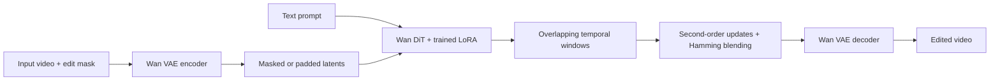

# Unified Long Video Inpainting and Outpainting

[](https://arxiv.org/abs/2511.03272)
[](LICENSE)
[](https://github.com/lvshq/Unified-Long-Video-In-Outpainting/actions/workflows/checks.yml)

Research code for **[Unified Long Video Inpainting and Outpainting via Overlapping High-Order Co-Denoising](https://arxiv.org/abs/2511.03272)**, by **Shuangquan Lyu, Jian Mao, and Yue Ma**.

Edit regions inside a video or extend its spatial canvas using a Wan 2.1 text-to-video backbone, mask-aware LoRA fine-tuning, and overlapping temporal denoising. This repository includes the modified DiffSynth-Studio implementation, training code, inference commands, and evaluation utilities.

> **Release status:** Source code is available. Trained LoRA checkpoints and the complete InpaintBench dataset are **not included**, and no public download links are currently provided. Inference requires a trained adapter; train one using the instructions below. This release has CPU regression coverage, but has not been validated end to end with the 14B model on a CUDA GPU. See [implementation notes](docs/IMPLEMENTATION.md) for differences between the supplied research code and the paper.

## Overview

- **Inpainting:** replace content inside a binary image/video mask.
- **Outpainting:** expand the latent canvas around the original video.
- **LoRA training:** mix interior and border masks with a weighted loss on edited and known regions.
- **Long-video inference:** combine overlapping latent windows with Hamming-weighted blending.
- **Evaluation:** background SSIM/LPIPS, edited-region CLIP similarity, and consecutive-frame tLPIPS.



## Installation

Use **Linux, Python 3.10 or 3.11, and an NVIDIA CUDA GPU**. The paper reports experiments on an H100; memory needs vary with resolution, window size, and offloading. CPU-only and Apple MPS generation are not supported by this release.

```bash
git clone https://github.com/lvshq/Unified-Long-Video-In-Outpainting.git
cd Unified-Long-Video-In-Outpainting
python3.10 -m venv .venv
source .venv/bin/activate
python -m pip install --upgrade pip

# Example CUDA 12.4 environment; select a compatible build for your driver.
python -m pip install torch==2.5.1 torchvision==0.20.1 --index-url https://download.pytorch.org/whl/cu124
python -m pip install -e .
```

Run commands from the repository root. Install additional dependencies as needed:

```bash
python -m pip install -r requirements-train.txt  # training
python -m pip install -r requirements-eval.txt   # evaluation (includes Linux Decord)
```

The inherited DiffSynth modules retain their `diffsynth` import name. Use a dedicated environment to avoid conflicts with another DiffSynth installation. Legacy applications and unrelated model examples may need their own optional dependencies.

## Model weights

Download the original **[Wan-AI/Wan2.1-T2V-14B](https://huggingface.co/Wan-AI/Wan2.1-T2V-14B)** checkpoint layout:

```bash
python - <<'PY'
from huggingface_hub import snapshot_download
snapshot_download(
    repo_id="Wan-AI/Wan2.1-T2V-14B",
    local_dir="models/WanVideo/Wan2.1-T2V-14B",
    allow_patterns=[
        "diffusion_pytorch_model-*.safetensors",
        "models_t5_umt5-xxl-enc-bf16.pth", "Wan2.1_VAE.pth",
        "google/umt5-xxl/*", "config.json", "LICENSE.txt",
    ],
)
PY
```

Expected files:

```text
models/WanVideo/Wan2.1-T2V-14B/
├── diffusion_pytorch_model-00001-of-00006.safetensors
├── ... (all six DiT shards)
├── models_t5_umt5-xxl-enc-bf16.pth
├── Wan2.1_VAE.pth
└── google/umt5-xxl/
```

Supply a trained editing adapter through `--lora`. The base model alone is insufficient for the adapted method. Model files, cached training tensors, and outputs are ignored by Git.

## Inference

### Inpainting

Provide an aligned binary mask: **white (255) means edit; black (0) means preserve**. A mask image is reused for all frames; a mask video must match the input's dimensions and frame count.

```bash
python -m scripts.inference \
  --task inpainting \
  --input data/input.mp4 \
  --mask data/mask.png \
  --prompt "A golden retriever surfing on a blue ocean wave" \
  --model-dir models/WanVideo/Wan2.1-T2V-14B \
  --lora models/editing_lora.ckpt \
  --output outputs/inpainting.mp4
```

Use `--center-mask` for the original fixed central latent hole, or `--gray-overlay` for a video already containing gray holes (128 ± 2). Binary masks avoid confusing naturally gray content with an edit region. Known pixels are encouraged by training rather than clamped during denoising, so exact pixel preservation is not guaranteed.

### Outpainting

The output canvas defaults to double the input height and width, with the source centered in latent space. Set `--height` and `--width` to choose a larger canvas.

```bash
python -m scripts.inference \
  --task outpainting \
  --input data/input.mp4 \
  --prompt "A surfer riding a wave, surrounded by a wide ocean landscape" \
  --model-dir models/WanVideo/Wan2.1-T2V-14B \
  --lora models/editing_lora.ckpt \
  --output outputs/outpainting.mp4
```

Dimensions must be multiples of 16. Inpainting keeps the input resolution. Sequences are padded by repeating the last frame to satisfy Wan's `4k+1` requirement, then trimmed to the original length when saved. FPS defaults to the input; `--fps` changes playback rate without resampling.

| Option | Default | Purpose |
| --- | --- | --- |
| `--window-frames` | `81` | Denoising budget, mapped to `floor(N/4)` latent frames in the original implementation. |
| `--overlap-factor` | `3` | Window/stride ratio; `0` uses one full-sequence window. |
| `--solver` | `midpoint` | Original second-order midpoint update, or `euler` for an ablation. |
| `--strength` | `0.7` | Noise strength applied to the masked/padded input. |
| `--steps` | `50` | Denoising steps. |
| `--lora-scale` | `0.7` | Scale applied when merging the adapter. |
| `--seed` | `1` | Noise seed. |

Each output gets a JSON sidecar with the arguments and resolved dimensions. `--persistent-dit-params` controls the DiT parameters kept on the GPU. Attention operates within each temporal window, but full-sequence VAE inputs/outputs and latent buffers still consume memory proportional to video length.

## Training

Prepare your own videos and captions:

```text
data/my_dataset/
├── metadata.csv
└── train/
    ├── clip_001.mp4
    └── clip_002.mp4
```

```csv
file_name,text
clip_001.mp4,"A dog walking across a grassy field."
clip_002.mp4,"Waves breaking along a rocky coastline."
```

An example caption file is included at [configs/training_metadata_example.csv](configs/training_metadata_example.csv); its referenced videos are not bundled.

Each clip must contain at least 81 frames. Preprocessing takes the first 81 frames, resizes and center-crops to 416×240, and caches text embeddings and VAE latents beside the videos as `.tensors.pth` files. Prepare any desired temporal resampling beforehand.

```bash
bash examples/wanvideo/train.sh \
  data/my_dataset \
  models/WanVideo/Wan2.1-T2V-14B \
  outputs/training
```

This runs preprocessing followed by LoRA training with rank/alpha 16, learning rate `1e-4`, masked-loss weight `0.9`, and 2,000 steps (4 epochs × 500 batches, on one GPU with default accumulation). On a multi-GPU host, set `CUDA_VISIBLE_DEVICES=0` for a single GPU. Adapter checkpoints appear beneath `outputs/training/`; pass your selected `.ckpt` to `--lora`.

```bash
python examples/wanvideo/train_wan_t2v.py --help
```

`--pretrained_lora_path` initializes adapter weights; it does not restore optimizer state. Training here applies the dual-region loss to latent flow-prediction errors. See [implementation notes](docs/IMPLEMENTATION.md) for the distinction from the paper.

## Evaluation

Reference, prediction, and mask must be temporally and spatially aligned. For outpainting, prepare the reference on the expanded canvas and mark the new border white in the mask.

```bash
# Background fidelity.
python -m scripts.evaluate ssim-lpips \
  --reference data/reference.mp4 --prediction outputs/inpainting.mp4 \
  --mask data/mask.png --output outputs/spatial_metrics.json

# Prompt similarity in the union bounding box of each frame's edit mask.
python -m scripts.evaluate clip \
  --video outputs/inpainting.mp4 --mask data/mask.png \
  --prompt "A golden retriever surfing on a blue ocean wave" \
  --output outputs/clip.csv

# Consecutive-frame LPIPS, without optical-flow compensation.
python -m scripts.evaluate tlpips \
  --video outputs/inpainting.mp4 --output outputs/tlpips.csv
```

SSIM is averaged over the evaluated region. LPIPS compares composites that are identical outside it; receptive fields still cross mask boundaries. CLIP uses `ViT-B-32` / `openai` and reports `max(100 × cosine_similarity, 0)`; omitting `--mask` evaluates full frames. tLPIPS defaults to VGG, while spatial LPIPS defaults to AlexNet. Record model choices and sampling FPS when comparing results. Metric models download their weights on first use.

These tools do not reproduce paper tables automatically: the complete benchmark, trained adapter, and exact experiment configurations are not bundled. The legacy `gen_*.py` filenames remain as command-line entry points.

## Repository layout

```text
diffsynth/                     Vendored backend and modified Wan pipeline
scripts/inference.py           Configurable video editing
scripts/evaluate.py            SSIM/LPIPS, CLIP, and tLPIPS commands
examples/wanvideo/train.sh     Preprocessing + training launcher
examples/wanvideo/train_wan_t2v.py
configs/example_prompts.json   Available original experiment prompts
docs/IMPLEMENTATION.md         Implementation differences and release changes
docs/UPSTREAM_README.md        Original DiffSynth-Studio documentation
tests/                        CPU regression tests
test_lora.ipynb                Exploratory notebook, with saved outputs cleared
```

Upstream `apps/` and unrelated model examples are retained for completeness. The notebook and legacy examples reference local experimental assets; use the commands above as the supported entry points.

## Development checks

```bash
python -m pip install ruff==0.11.13
python -m unittest discover -s tests -v
python -m compileall -q diffsynth examples scripts
bash -n examples/wanvideo/train.sh
```

GitHub Actions runs CPU regression and source checks without downloading Wan checkpoints.

## Citation

```bibtex
@article{lyu2025unified,
  title   = {Unified Long Video Inpainting and Outpainting via Overlapping High-Order Co-Denoising},
  author  = {Lyu, Shuangquan and Mao, Jian and Ma, Yue},
  journal = {arXiv preprint arXiv:2511.03272},
  year    = {2025},
  doi     = {10.48550/arXiv.2511.03272},
  url     = {https://arxiv.org/abs/2511.03272}
}
```

## Acknowledgments and license

Built on [DiffSynth-Studio](https://github.com/modelscope/DiffSynth-Studio) and [Wan 2.1](https://github.com/Wan-Video/Wan2.1). We thank their authors and contributors.

Code is distributed under the existing [Apache License 2.0](LICENSE). See [NOTICE](NOTICE) for attribution. Downloaded weights, datasets, and third-party assets retain their respective licenses.
